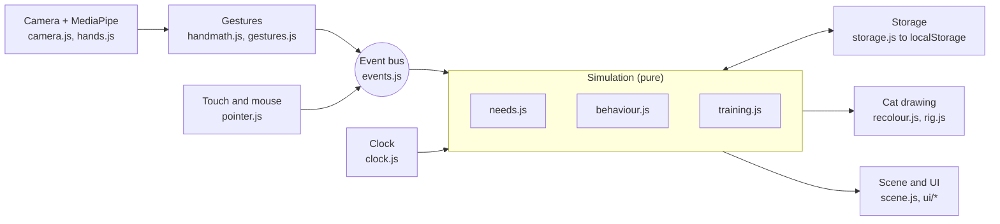

# My Virtual Pet — v1 Plan

Version of 31 October 2026. This file is the build specification. It starts from the plan doc "Hand-Tracked Virtual Pet — v1 Build Plan" and adds the fixes and clarifications listed in `DECISIONS.md` §3.

**Which file wins.** `DECISIONS.md` records every later change and wins if it disagrees with this file. When that happens, Claude Code updates this file in the same session. The online plan doc is not updated automatically.

## Contents

1. [Summary](#1-summary)
2. [Decisions and flagged additions](#2-decisions-and-flagged-additions)
3. [Requirements traceability](#3-requirements-traceability)
4. [Platform and architecture](#4-platform-and-architecture)
5. [Needs, energy and sleep](#5-needs-energy-and-sleep)
6. [Hand tracking and gestures](#6-hand-tracking-and-gestures)
7. [Tricks and training](#7-tricks-and-training)
8. [Pet design and art](#8-pet-design-and-art)
9. [Mini view, taskbar and alerts](#9-mini-view-taskbar-and-alerts)
10. [Build phases](#10-build-phases)
11. [Later phases (outside v1)](#11-later-phases-outside-v1)
12. [Risks and mitigations](#12-risks-and-mitigations)
13. [Sources](#13-sources)

---

## 1. Summary

v1 is a hand-tracked virtual cat. It installs from one codebase as an app on Daniella's Windows laptop (taskbar) and iPad (Home Screen and Dock). The build runs in seven phases (0 to 6). Each phase is one Claude Code session, followed by testing on both devices.

**Why a cat.** It is the easiest species that still supports every interaction asked for.

- Cats spend most of their time sitting, loafing and sleeping in one spot, so v1 needs no walking animation.
- Every interaction has a natural cat version: petting (purring), food and water bowls, a feather wand for play, tricks, naps.
- Cat breeds differ mostly in ears, tail and coat, so a breed is a set of swappable parts, not a new body.
- Each other species is harder in some way. A fish is simpler to animate but cannot be petted. A bird needs flight. Dog breeds vary hugely in body shape.

**Why an installable web app.** It is the only route that reaches both devices from one codebase without a Mac.

- **Laptop (Windows 11):** open the app's link in Microsoft Edge (built into Windows) or Chrome and install it once. After that it opens in its own window with its own taskbar icon, not in a browser tab.
- **iPad:** in Safari, tap Share, then Add to Home Screen. On iPadOS 26, sites added this way open as full-screen web apps by default.
- **Native iPad app:** this would need Xcode, which only runs on a Mac, plus a paid Apple Developer membership.

**Three things v1 cannot do, and what it does instead.**

| Requested | Why it is not in v1 | What v1 does instead |
| --- | --- | --- |
| Alerts while the app is fully closed | A closed web app cannot schedule its own notifications. Chrome's scheduled-notification API finished its trial but never launched. Alerts need a small push server. | The pet looks sad when the app is open and in the mini view. Push alerts are later phase L1. |
| App icon becomes the pet | Once an icon is on the Home Screen it never updates (WebKit bug 216197). | Phase 6 experiment: generate the install icon from the cat just before installing. |
| Pet on the desktop or Home Screen while the app is closed | A web app can only draw inside its own window. | A mini view when the window is small. On the laptop, also a floating always-on-top mini window while the app is open. |

**Biggest risk.** Camera access inside iPad Home Screen web apps has a history of WebKit bugs. Phase 0 therefore proves hand tracking on the iPad before anything else is built.

---

## 2. Decisions and flagged additions

The current status of every decision is in `DECISIONS.md` §1. These are the defaults as planned.

| ID | Decision | Default | Why it matters |
| --- | --- | --- | --- |
| D1 | Art style | Illustrated "cut-out" cat drawn in Krita. Each body part is drawn once and animated by code. | Far less drawing than frame-by-frame, and soft gradients work natively. The alternative is pixel art in Aseprite (§8.10). |
| D2 | When the art arrives | Phase 5. Phases 1 to 4 use a code-drawn placeholder cat built from the same parts. | Building never waits on art, and the real art drops in without code changes. |
| D3 | Hosting the HTTPS link | GitHub Pages, with git | The iPad allows the camera only on HTTPS pages, and git lets any phase be undone. Free GitHub Pages needs a public repository (§12). Fallback without git: Netlify Drop. |
| D4 | Default needs mode | Live: needs keep dropping slowly while the app is closed. Relaxed is a settings switch. | Changing needs are the norm; switching them off is the option. |
| D5 | What happens at 0 | Only sadness. The cat never gets ill, runs away or dies. | Keeps it "just for fun". |
| D6 | Breeds in v1 | Domestic Shorthair, Scottish Fold, Siamese | All short-haired; they differ only in ears and tail, so each breed is a few extra parts. Long-haired breeds come later. |
| D7 | The mini view counts as | Away: needs use the slow 1 to 6 hour rates | The mini view is passive. With in-app rates the cat would turn sad within an hour while Daniella works. |
| D8 | App name | Not chosen; needed by Phase 6 | Used for the install name, the icon label and the window title. |
| D9 | Hand recordings (Phase 2 test files) | Kept on the laptop only (git-ignored) | They describe the shape and movement of Daniella's hand, and the repository is public. Replay tests skip, with a visible note, where the files are missing. |
| Q1 | Access to a Mac? | — | Affects only later phase L4 (native iPad app). |

**Flagged additions.** These were not in the original request. Each is included for the reason given and can be struck in `DECISIONS.md`.

| ID | Addition | Phase | Reason |
| --- | --- | --- | --- |
| A1 | Touch and mouse controls for everything | 1 | Hand tracking fails in poor light or when camera access is refused, and touch is natural on the iPad. It also lets the game be built and tested before hand tracking exists. |
| A2 | First-run tutorial | 6 | Teaches the pinch and the thumb taps, and says that the camera image never leaves the device. |
| A3 | Save backup (export and import a file) | 6 | Protects the cat if browser data is cleared, and lets a cat move between devices by hand. |
| A4 | Developer panel (hidden by default) | 1 | Live gesture readings and time controls, so 6-hour decay can be tested in seconds. |
| A5 | git from Phase 0 | 0 | Every phase becomes a checkpoint that can be returned to. |
| A6 | On-screen error log | 0 | The iPad has no developer console without a Mac, so iPad errors must be visible on screen to be diagnosed. Added 31 Oct 2026. |

**Design rules that always apply**

- The camera is off whenever the app is hidden, in the mini view, or switched off in settings.
- Nothing the camera sees is stored or sent anywhere. Only landmark numbers exist, in memory. The developer panel's recorder (§6.8) saves landmark numbers only, never images, only when Daniella presses Record, and by default keeps the files off GitHub (D9).
- v1 has no sound. Purring and mewing are shown visually (§8.9). Sound is a later idea (L5).

---

## 3. Requirements traceability

All 22 requested features are accounted for: 17 fully in v1, 3 partly, and 2 in later phases.

| # | Requested | Scope | How v1 meets it, and where |
| --- | --- | --- | --- |
| R1 | Pet the cat by stroking with your hand | In v1 | Open-palm stroke over the cat. Phase 2. |
| R2 | Pick up food or water with your hand to feed | In v1 | Pinch to grab a bowl, release it at the cat. Phase 2. |
| R3 | Play using hand movements | In v1 | Point to hold a feather wand; the cat tracks and pounces. Phase 2. |
| R4 | Thumb-to-fingertip taps trigger tricks | In v1 | Thumb + middle = Sit pretty, thumb + ring = High-five, thumb + pinky = Spin. Phase 4. |
| R5 | Tricks improve with practice; some pets learn faster | In v1 | Mastery from 0 to 100, plus a hidden learning speed per cat. Phase 4. |
| R6 | Choose the species (dog, cat, bird, fish) | Later phase | v1 is cat only. Later phase L3 adds species. |
| R7 | Coat colours and patterns, including patches | In v1 | 7 patterns, any colour. Phase 5. |
| R8 | Gradients on scales | Later phase | Arrives with fish in L3. In v1, fur gets a soft gradient through the Colourpoint pattern. |
| R9 | Choose the breed | In v1 | 3 breeds (D6). Phase 5. |
| R10 | Other customisable features | In v1 | Eye colour, nose and paw-pad colour, name. Phase 5. |
| R11 | Needs that rise and fall | In v1 | Hunger, thirst, fun, affection. Phase 1. |
| R12 | Switch off needs dropping while away | In v1 | Relaxed mode. Phase 1. |
| R13 | Energy, with the pet sleeping sometimes | In v1 | Logic in Phase 1, animation in Phase 3. |
| R14 | Needs drop every 30 to 60 s while in the app | In v1 | Exact rates in §5.1. Phase 1. |
| R15 | Needs drop every 1 to 6 h while away | In v1 | Exact rates in §5.1. Phase 1. |
| R16 | Lives on the taskbar as its own app, not tied to Chrome | In v1 | Installs from Edge or Chrome, then runs in its own window with its own taskbar icon. Phase 0, finished in Phase 6. |
| R17 | Works on laptop and iPad | In v1 | Phase 0 proves both devices before anything else is built. |
| R18 | Pet alone in a corner of the screen | Partly in v1 | Mini view, plus a floating mini window on the laptop while the app is open. A desktop pet while closed is L2; an iPad Home Screen widget is L4. |
| R19 | Alert when a need is low | Partly in v1 | The pet looks sad in the app and the mini view, and the window title changes. Alerts while closed are L1. |
| R20 | Pet looks sad in the corner view | In v1 | Phase 6. |
| R21 | App icon becomes your pet | Partly in v1 | Install-time icon experiment in Phase 6. Live icon changes need the Windows desktop app (L2). |
| R22 | Start with the easiest species | In v1 | Cat (§1). |

---

## 4. Platform and architecture

### 4.1 Overview

One web codebase runs on both devices: plain JavaScript modules, no framework, no build step for the game itself. It is served over HTTPS from GitHub Pages and installed once per device. Everything runs on the device; no server is involved in v1.



Touch, mouse and hands all feed one event bus, so the game logic never knows which input was used. Drawing only reads the simulation's state, and only `storage.js` reads or writes the save.

### 4.2 Installing on each device

- **Laptop (Windows 11):** open the app's address in Edge. Choose Settings and more (…), then Apps, then Install this site as an app; in some Edge versions Apps sits under More tools. Installed sites behave like Windows applications and can be pinned to the taskbar. Chrome works the same way.
- **iPad:** open the address in Safari, tap Share, then Add to Home Screen, keep Open as Web App switched on, and tap Add. Drag the icon into the Dock if wanted.

### 4.3 Stack

| Part | Choice | Reason |
| --- | --- | --- |
| Code | Plain JavaScript (ES2022 modules), HTML, CSS | Nothing to install or configure for the game itself; Claude Code edits the files directly. |
| Hand tracking | MediaPipe Hand Landmarker (`@mediapipe/tasks-vision`), exact version pinned, files copied into `vendor/mediapipe/` | Runs in Edge, Chrome, Firefox and Safari; Google's web samples need iOS or iPadOS 16 or later, and this plan assumes iPadOS 16.4 or later. Local copies work offline and never change by surprise. |
| Drawing | One `<canvas>` for the room and the cat; HTML for menus and the HUD | Recolouring works on canvas pixels. |
| Saving | `localStorage`, read and written only by `src/storage.js` | The save is one small JSON object with a single owner. |
| Install and offline | `manifest.webmanifest` (display: standalone) plus a service worker, `sw.js` | Gives the app its own window and lets it open without internet. |
| Hosting | GitHub Pages (D3) | Free HTTPS; browsers allow the camera only on secure pages. |
| Logic tests | Node.js built-in test runner: `npm test` runs `node --test` | Claude Code runs them itself after every change; no test library needed. |
| Local server | `serve` 14.2.6 through `npm run serve`, at http://localhost:3000 | `localhost` counts as secure, so the camera works there without HTTPS. |
| Art tool (Phase 5) | Node script `tools/build-art.mjs`; any libraries it needs are exact-version devDependencies | Turns the Krita export into images the game loads. |

### 4.4 Files

```text
MyVirtualPet/
├─ README.md                 start here (for Daniella)
├─ KICKOFF-PROMPT.md         the first message for Claude
├─ CLAUDE.md                 standing rules Claude Code loads every session
├─ DECISIONS.md              live decisions, versions, tuned values, phase log
├─ .claude/                  settings.json (plan mode by default) and skills:
│                            /start-phase, /deploy, /handoff, /finish-phase
├─ docs/                     PLAN.md, WORKFLOW.md, SETUP.md, ART-GUIDE.md,
│                            phases/phase-0.md … phase-6.md,
│                            HANDOFF.md (exists only while a phase is paused)
├─ index.html                the one page; never changes its URL or hash
├─ manifest.webmanifest
├─ sw.js                     service worker; APP_VERSION on line 1
├─ .nojekyll                 tells GitHub Pages to serve files exactly as they are
├─ package.json              "type": "module"; scripts test and serve; dev-only tools
├─ icons/                    icon-192.png, icon-512.png, apple-touch-icon.png (180 × 180)
├─ vendor/mediapipe/         vision_bundle.mjs, wasm/, hand_landmarker.task,
│                            package.json (records version and Apache-2.0 licence)
├─ art/
│  ├─ source/                cat.kra and cat.psd — Daniella's files, git-ignored
│  └─ build/                 atlas-0.png …, rig.json — made by tools/build-art.mjs
├─ tools/
│  ├─ build-art.mjs          Krita export → atlas images + rig.json (Phase 5)
│  └─ make-placeholder-icons.mjs   optional placeholder icons (Phase 0)
├─ src/
│  ├─ main.js                boot, game loop, wiring
│  ├─ version.js             APP_VERSION (same value as sw.js line 1)
│  ├─ config.js              every tunable number, copied from this plan; starts in Phase 0
│  ├─ clock.js               game time (developer controls can pause, speed or move it) and wall time
│  ├─ storage.js             the only module that reads or writes the save
│  ├─ events.js              the event bus and the fixed event vocabulary
│  ├─ sim/needs.js           meters, decay, Live/Relaxed, catch-up, moods (pure)
│  ├─ sim/behaviour.js       the cat's state machine (pure)
│  ├─ sim/training.js        tricks, mastery, learning speed (pure)
│  ├─ input/pointer.js       touch and mouse → events
│  ├─ input/camera.js        start, stop and retry the camera
│  ├─ input/hands.js         MediaPipe wrapper → raw landmarks per frame
│  ├─ input/hands.worker.js  detection in a worker (Phase 0 decision)
│  ├─ input/handmath.js      smoothing, mirroring, scene mapping, hand scale (pure)
│  ├─ input/gestures.js      palm, pinch, point, thumb taps → gesture state and events (pure)
│  ├─ render/rig.js          cut-out cat: hierarchy, pivots, poses, blending
│  ├─ render/placeholder.js  code-drawn placeholder cat (see §8.6)
│  ├─ render/recolour.js     rig.json layers + the cat's look → finished part images
│  ├─ render/poses.json      poses and animations (Phase 3)
│  ├─ render/scene.js        room, shelf, bowls, treat jar, wand, hand cursor
│  ├─ ui/creator.js          pet creation screens (Phase 5)
│  ├─ ui/hud.js              need bars, settings, trick panel
│  ├─ ui/mini.js             mini view and floating mini window (Phase 6)
│  ├─ ui/devpanel.js         developer panel (A4)
│  ├─ ui/errorlog.js         on-screen error log (A6)
│  ├─ ui/tutorial.js         first-run tutorial (A2, Phase 6)
│  ├─ ui/backup.js           save export and import (A3, Phase 6)
│  └─ ui/appicon.js          install-icon experiment (Phase 6)
└─ tests/
   ├─ *.test.js              logic tests (node --test)
   └─ fixtures/              hand recordings (Phase 2; kept off GitHub by default, D9), sample parts (Phase 3)
```

Files appear in the phase that first needs them; no phase creates files a later phase owns.

### 4.5 Engineering rules

These prevent known failure modes. Every phase keeps all of them.

1. **One event vocabulary.** Touch, mouse and hands all emit the same events: `cursor:move`, `cursor:hide`, `pet:stroke`, `grab:start`, `grab:move`, `grab:end`, `wand:move`, `wand:end`, `trick:sitpretty`, `trick:highfive`, `trick:spin`. The game never knows which input sent them, so the touch fallback cannot drift from hand play. New event names need approval. Payloads, in scene units: `cursor:move` {x, y}; `pet:stroke` {x, y, speed}; `grab:start` {item, x, y}, where item is `food`, `water` or `treat`; `grab:move` and `grab:end` {x, y}; `wand:move` {x, y}; the others carry nothing.
2. **Time from timestamps only.** Every change is computed from differences in `clock.now()`, never by counting timer ticks. Browsers slow timers in background windows, so counted ticks drift.
3. **No URL changes after the page loads.** No hash routing, no `pushState`, no `href="#"` links; use buttons. In iPad Home Screen apps a hash change has stopped the camera and re-asked permission (WebKit bug 215884).
4. **One persistence boundary.** Only `src/storage.js` touches `localStorage`. The save key is `vpet.save`, and every key starts with `vpet.`. Every GitHub Pages project on one account shares the web origin `<username>.github.io`, so storage is shared between projects unless keys are prefixed. The save is written after every meter change and action, every 10 s, and on `visibilitychange` (hidden) and `pagehide`. `navigator.storage.persist()` is requested at every launch.
5. **Pure logic is tested.** `src/sim/*`, `src/input/handmath.js`, `src/input/gestures.js` and the maths parts of `src/render/*` take inputs and return results. They use no DOM, no timers, no storage and no `Date.now()`. `npm test` runs `tests/*.test.js` with Node's built-in test runner.
6. **Pinned versions.** No CDN links, no `@latest`, no runtime npm dependencies. Vendored files live in `vendor/`. Development tools are exact-version devDependencies or exact-version `npx` calls. Every version is recorded in `DECISIONS.md` §4.
7. **No stale files.** Cache names are `vpet-<APP_VERSION>`, and the service worker's activate step deletes only caches whose names start with `vpet-`. Until Phase 6 the service worker fetches network-first with `cache: 'no-cache'` and falls back to the cache. GitHub Pages lets browsers reuse files for 10 minutes (`Cache-Control: max-age=600`), so without `no-cache` the iPad can run old files after a deploy. Every deploy bumps `APP_VERSION` (`/deploy` does it), and the version is visible on screen.
8. **Relative paths only** (`./…`). This includes the manifest's `start_url` and `scope`, the service worker registration, and the MediaPipe wasm folder. The app lives in a sub-folder (`/<repository>/`) on GitHub Pages. The manifest has no `id`: a relative `id` resolves against the origin, not the app's folder, so the app's identity is left to default to its `start_url`.
9. **Every tunable number lives in `src/config.js`**, copied from this plan. A number the plan does not give is proposed in the phase plan, approved by Daniella, and recorded in `DECISIONS.md`.
10. **Camera discipline.** The camera's first start after each launch needs a tap. After that it stops when the page is hidden, in the mini view, or when switched off, and restarts by itself on return if it was running. Images are never stored or sent.
11. **Errors are visible.** Window errors, unhandled promise rejections and `console.error` and `console.warn` calls go to the on-screen error log (A6) as well as the console.

### 4.6 Scene and layout

- The scene is a fixed logical area **1000 units wide and 700 units tall**. It is scaled uniformly to fit the window and centred, and the margins around it are filled with the room's colours, so nothing looks letterboxed.
- Every position, distance and speed in this plan is in scene units, so the same numbers work on every screen.
- The canvas renders at the device's pixel ratio, capped at 2.
- Landscape suits the iPad best; portrait shows the same scene smaller.
- Object positions (shelf, food bowl, water bowl, treat jar, cat, the cat's mouth point) are proposed in Phase 1's plan, approved, stored in `config.js` and recorded in `DECISIONS.md`.

### 4.7 Save format (schema 1)

```json
{
  "schema": 1,
  "createdAt": 0,
  "lastSeenAt": 0,
  "settings": { "mode": "live", "camera": true, "preview": true, "dev": false, "tutorialDone": false },
  "pet": {
    "name": "Kitty",
    "species": "cat",
    "breed": "shorthair",
    "pattern": "tabby",
    "colours": { "base": "#c8742a", "second": "#5a3416", "third": null },
    "eyes": "green",
    "nose": "pink",
    "aptitude": 1.12,
    "affinity": { "sitpretty": 1.05, "highfive": 0.92, "spin": 1.10 }
  },
  "needs": { "hunger": 80, "thirst": 80, "fun": 80, "affection": 80, "energy": 90 },
  "progress": { "hunger": 0, "thirst": 0, "fun": 0, "affection": 0, "energy": 0, "rest": 0 },
  "asleep": false,
  "tricks": { "sitpretty": 0, "highfive": 0, "spin": 0 },
  "stats": { "commands": 0 }
}
```

- Times are milliseconds since 1970, as returned by `clock.now()`.
- `progress` stores how far each meter is toward its next one-point change, as a fraction, so partial time carries over between sessions. `progress.rest` does the same for the energy a cat regains while away (§5.7).
- `asleep` records whether the cat was asleep at the last save (§5.6).
- `breed` is one of `shorthair`, `fold`, `siamese`. `pattern` is one of `solid`, `bicolour`, `tabby`, `spotted`, `calico`, `tortoiseshell`, `colourpoint`. `eyes` is one of `green`, `gold`, `copper`, `blue`, `odd`. `nose` is one of `pink`, `black`, `brown`. Colours are `#rrggbb`; unused colour slots are `null`.
- `settings.dev` is developer mode: opening the developer panel turns it on, and Reset save turns it off. In Phase 1 it adds a warning for unknown event names.
- `settings.camera` is the camera switch in settings. When on, the app shows a "Turn on camera" button at launch; it never starts the camera by itself. `settings.preview` is the camera-preview switch (§6.5). `settings.tutorialDone` records that the first-run tutorial (A2) was finished or skipped.
- `stats.commands` counts every trick command given (used for the learning-style label, §7.4).
- **The first save** (Phase 1) is a default cat: Domestic Shorthair, orange tabby (as above), green eyes, pink nose, named "Kitty", with aptitude and affinity rolled as in §7.3 and rounded to 2 decimal places. Its `createdAt` and `lastSeenAt` are the moment it's made; the 0 above is the time the test uses. Phase 5's creator replaces it with the player's own cat.
- Any change to this shape raises `schema` and adds a migration in `storage.js`.
- If the save cannot be read, its raw text is kept under `vpet.save.broken`, a fresh save starts, and the app says so on screen.

### 4.8 Version and developer access

- `APP_VERSION` is `0.N.x` while phase N is being built, where N is the last finished phase tag plus 1 (0 before any tag). `/deploy` raises x by one. Finishing Phase 6 sets `1.0.0`.
- The same value is written in `src/version.js` and on line 1 of `sw.js`; `tests/version.test.js` checks they match.
- The version label sits in a corner of the screen. Tapping or clicking it 5 times within 3 s opens the developer panel (A4), which includes the error log (A6). In Phase 0, before the panel exists, it opens the error log. From Phase 1 the log is the panel's Errors tab; `errorlog.js` still owns the label and opens the panel, so the Errors tab works even if the game fails to load.

---

## 5. Needs, energy and sleep

Five meters run from 0 to 100 and are always kept inside that range. Four of them drop one point at a time on fixed intervals inside the requested 30 to 60 s and 1 to 6 h ranges. Energy drains with activity and refills with sleep. Every number below goes into `config.js`.

### 5.1 Meters

| Meter | Raised by | In app: −1 point every | Away, Live mode: −1 point every | Gain per action |
| --- | --- | --- | --- | --- |
| Hunger | Eating; treats | 45 s | 2 h | +35 per meal; +5 per treat |
| Thirst | Drinking | 35 s | 1 h | +40 per drink |
| Fun | Wand play, tricks | 40 s | 4 h | +2 per pounce; +3 per successful trick |
| Affection | Petting | 60 s | 6 h | +1 per 0.5 s of stroking (2 per second) |

What these rates mean in practice: going from full to below 30 ("needs attention") takes 71 drops. That is 41 to 71 minutes with the app open. While away it takes 3.0 days for thirst, 5.9 days for hunger, 11.8 days for fun and 17.8 days for affection. If the cat should need attention sooner while away, raise the points per drop (for example −5), not the interval.

### 5.2 Energy and sleep

| Situation | Energy change |
| --- | --- |
| Awake and calm, app open | −1 every 30 s |
| Chasing the wand | an extra −1 every 5 s |
| Each trick command | −1 at once |
| Asleep, app open | +1 every 6 s (20 to 100 takes 8 minutes) |
| Away, Live mode | +1 every 10 minutes: the cat rests |
| Away, Relaxed mode | No change |

- The cat falls asleep when energy is 20 or below, once its current action finishes.
- It also naps when nobody has interacted for 3 minutes and energy is below 60. Any vocabulary event except `cursor:move` and `cursor:hide` counts as an interaction.
- It wakes on its own when energy reaches 100. v1 has no way to wake it early.
- While it sleeps, tricks, play and feeding (including treats) are ignored, a sleep bubble shows, and a held item floats back to the shelf. Petting still raises affection (+1 per 0.5 s) and shows a sleepy purr. An item picked up while it sleeps floats back when released.
- In the app, `progress.energy` counts toward the next ±1 in the current direction and resets to 0 when the cat falls asleep or wakes. While away, `progress.rest` counts toward the next +1 and carries over between catch-ups, so the mini view's once-a-minute catch-ups add up.

### 5.3 Live and Relaxed modes

- **In app** means the page is visible. Minimised, hidden or closed counts as **away**.
- **Live** (default, D4): away rates apply while Daniella is gone.
- **Relaxed:** every meter freezes while away and resumes on return. In-app rates still apply while the app is visible.
- **The mini view** counts as away (D7). In the mini view, catch-up (§5.7) runs once a minute so the mini cat stays current.

### 5.4 Moods

Moods use the four needs only: hunger, thirst, fun and affection. Energy never affects mood; a tired cat sleeps, it is not sad. The lowest of the four decides the mood.

| Mood | Trigger | What you see |
| --- | --- | --- |
| Happy | All four needs at 60 or above | Normal idle animations |
| Okay | Lowest need from 30 to 59 | Normal idle animations |
| Needs attention | Lowest need below 30 | Ears lowered, slow tail, sad eyes; that need's icon pulses |
| Urgent | Lowest need below 15 | Lies down (§8.9) and mews (a small "mew" bubble) |

At 0 nothing worse happens (D5).

### 5.5 Feeding and treats

- A shelf holds a food bowl, a water bowl and a treat jar. Food, water and treats never run out.
- **Bowls:** a bowl released within 120 scene units of the cat's mouth while the cat is awake is used if that meter is below 95. The cat eats or drinks for 3 s and gains +35 hunger or +40 thirst. At 95 or above it sniffs and turns away. Either way the bowl then floats back to the shelf.
- **Treats:** pinch (or drag) one treat out of the jar. Released within 120 units of the mouth while the cat is awake, it is always eaten (1 s, +5 hunger). Inside a reward window it also counts as the reward (§7.2).
- An item released anywhere else, or while the cat is asleep, floats back to the shelf over 0.5 s; a treat fades out over the same time.

### 5.6 Behaviour states

| State | Enters when | Leaves when | Animation |
| --- | --- | --- | --- |
| Idle | Nothing else applies | Any other trigger | Sitting loop; every 8 to 15 s a random extra: groom, stretch, tail flick, look at cursor |
| Petted | `pet:stroke` at 80 to 1200 units/s while awake (faster makes it flinch instead) | 0.8 s after stroking stops | Eyes close, purrs, leans into the hand |
| Eating or drinking | A bowl or treat is used (§5.5) | After 3 s (bowl) or 1 s (treat) | Head down, chewing or lapping |
| Playing | `wand:move` while awake and energy above 20 | 2 s after `wand:end`, or at once when energy reaches 20 (the cat then falls asleep) | Tracks the wand; pounces when it moves faster than 400 scene units per second, at most once per second (+2 fun per pounce) |
| Trick | A trick command that the cat attempts (§7.2) | The animation ends | The trick, or a confused head tilt |
| Asleep | The sleep rules in §5.2 | Energy reaches 100 | Curls up, slow breathing, sleep bubble |

- When two triggers arrive together, the order is: Asleep, Eating or drinking, Trick, Playing, Petted, Idle. A higher-priority trigger takes over at once (a bowl dropped during play is eaten); a lower one is ignored (strokes during a meal do nothing).
- Details settled in Phase 1 (`DECISIONS.md` §3): sleep at energy 20 waits for a meal to finish or petting to end; the 3-minute nap timer counts from the last interaction, or from launch; a meal's gain arrives when it ends; stroking time counts the gaps between strokes that come within 0.8 s of each other; flinch, sniff, pounce and the idle extras are short reactions, not states; only one treat is out at a time.
- The sad moods change the idle animation and expressions but never block an action.
- **On launch**, after catch-up, the cat is Asleep if `asleep` was true and energy is below 100, or if energy is 20 or below. Otherwise it is Idle. The behaviour state itself is not saved.

### 5.7 Time handling

The simulation uses one rule: change equals elapsed time divided by the interval, with the remainder kept in `progress`. Elapsed time always comes from timestamps. This sketch shows the away case; Phase 1 may return a new object instead of changing its argument.

```js
// Runs on launch, when the page becomes visible, once a minute in the mini view,
// and whenever the game loop sees a gap longer than 10 s (laptop slept, tab frozen).
export function catchUp(save, now, cfg) {
  let away = now - save.lastSeenAt;
  if (!(away > 0)) away = 0;                          // clock moved backwards: no change
  away = Math.min(away, cfg.maxAwayMs);               // cap at 30 days
  if (save.settings.mode === 'relaxed') away = 0;     // Relaxed: everything freezes while away
  for (const m of ['hunger', 'thirst', 'fun', 'affection']) {
    const p = save.progress[m] + away / cfg.awayMs[m];
    const drops = Math.floor(p + 1e-9);               // 1e-9: floating-point error never loses a point
    save.needs[m] = Math.max(0, save.needs[m] - drops);
    save.progress[m] = Math.max(0, p - drops);
  }
  const r = save.progress.rest + away / cfg.awayEnergyGainMs;
  const gain = Math.floor(r + 1e-9);                  // rest carries over, so 1-minute
  save.needs.energy = Math.min(100, save.needs.energy + gain);
  save.progress.rest = Math.max(0, r - gain);         // catch-ups in the mini view add up
  save.lastSeenAt = now;
  return save;
}
```

The in-app tick uses the same pattern with the in-app intervals and the energy rules in §5.2. It runs only while the page is visible, receives the elapsed milliseconds since the previous tick, and also updates `lastSeenAt`. Elapsed time of 0 or less (the clock moved back) changes nothing. A gap longer than 10 s is handed to `catchUp` instead. The developer panel's "In app for" control calls the in-app tick directly with the whole duration, bypassing the gap rule.

**Time sources (Phase 1, `DECISIONS.md` §3).** Game time, `clock.now()`, drives the cat; the developer panel can pause it, speed it up or move it. The 10 s gap is measured on unscaled wall time, `clock.wallNow()`, through the pure `chooseUpdate` in `needs.js`: frame times can stop while a computer sleeps, and a slow frame at 60× must not count as away. Game time that moved back also goes to `catchUp`, which changes nothing and re-bases `lastSeenAt`, and the cat's timers shift with it. Touch speeds, the 300 ms hold, items floating back and the 10 s autosave use the browser's own event and frame times.

### 5.8 Worked examples

These are exact expected values for tests and for manual checks with the developer panel, which applies time in one step. Start: hunger 80, thirst 80, fun 80, affection 80, energy 90, all progress 0, Live mode, cat awake.

| Scenario | Hunger | Thirst | Fun | Affection | Energy |
| --- | --- | --- | --- | --- | --- |
| Away 6 h | 77 | 74 | 79 (progress 0.5) | 79 | 100 |
| Then away 2 h more | 76 | 72 | 78 | 79 (progress 0.33) | 100 |
| Relaxed mode, away 6 h | 80 | 80 | 80 | 80 | 90 |
| Away 40 days (counted as 30) | 0 | 0 | 0 | 0 | 100 |
| Clock moved back 1 h | 80 | 80 | 80 | 80 | 90 |
| In app 10 min, awake and calm | 67 | 63 | 65 | 70 | 70 |
| In app 10 min, then fed once | 100 | 63 | 65 | 70 | 70 |
| Mini view 2 h: 120 catch-ups of 1 min each | 79 | 78 | 80 (progress 0.5) | 80 (progress 0.33) | 100 |

---

## 6. Hand tracking and gestures

One hand is tracked at a time, and five hand states drive every interaction. Each uses thresholds scaled to the size of the hand, a minimum hold time, and hysteresis (separate start and end thresholds), so a single jittery frame cannot trigger anything. Every number here is a starting value in `config.js`, tuned on Daniella's hands in Phase 2.

### 6.1 Pipeline

1. **Camera.** `getUserMedia({ video: { facingMode: 'user', width: { ideal: 640 }, height: { ideal: 480 }, frameRate: { ideal: 30 } }, audio: false })`, first started after each launch by a tap on "Turn on camera". The `<video>` element has `playsinline`, `muted` and `autoplay`. Call `video.play()` after attaching the stream, and start detecting once `video.videoWidth` is above 0.
2. **Detector.** `HandLandmarker` with `runningMode: 'VIDEO'`, `numHands: 1`, and `minHandDetectionConfidence`, `minHandPresenceConfidence` and `minTrackingConfidence` at their 0.5 defaults. `baseOptions.delegate: 'GPU'` first; if creation fails, create again with `'CPU'`, and if the first detection with GPU fails, switch to `'CPU'` once. The wasm files load through `FilesetResolver.forVisionTasks('./vendor/mediapipe/wasm')`.
3. **Run only on new frames.** Call `detectForVideo(video, timestamp)` only when `video.currentTime` has changed. The timestamp is `performance.now()` and must be strictly greater than the previous one.
4. **Mirror.** Feed the unmirrored video to the detector, then mirror the output (x becomes 1 − x), so moving the hand right moves the cursor right. The on-screen preview is mirrored with CSS to match.
5. **Smooth.** Pass each landmark used through a One Euro filter (start with minCutoff 1.0, beta 0.007, dCutoff 1.0).
6. **Map to the scene.** The central part of the camera frame (x from 0.15 to 0.85, y from 0.10 to 0.80) maps to the whole scene, clamped at the edges, so the hand never needs to reach the edge of the frame.
7. **Scale.** *s* is the distance from the wrist (landmark 0) to the middle-finger knuckle (landmark 9). Every distance threshold below is a multiple of *s*, so gestures work near to or far from the camera. Distances are measured in video pixels (x × videoWidth, y × videoHeight), not raw normalised units, because those are stretched differently in x and y.

Detection calls are synchronous and block the page while they run; Google suggests running them in a web worker. Phase 0 measures this: if one detection takes more than 12 ms on the iPad (judged on the 60-detection average, with a hand in view), detection moves into a worker. **Decided in Phase 0 (`DECISIONS.md` §3): detection runs in `src/input/hands.worker.js`.** The page fetches the worker's files, so the service worker stores them, and lends MediaPipe a canvas from the page; if the worker can't start, detection runs on the page.

### 6.2 Landmarks used

| Index | Point |
| --- | --- |
| 0 | Wrist |
| 4 | Thumb tip |
| 5, 9, 13, 17 | Knuckles of index, middle, ring and pinky |
| 6, 10, 14, 18 | Middle joints of index, middle, ring and pinky |
| 8, 12, 16, 20 | Tips of index, middle, ring and pinky |

A finger counts as extended when the wrist-to-tip distance is more than 1.15 times the wrist-to-middle-joint distance.

### 6.3 Gestures

| Gesture | Rule | Cursor point | Effect |
| --- | --- | --- | --- |
| Open palm | Index, middle, ring and pinky extended; no pinch | Palm centre: the average of landmarks 0, 5, 9, 13, 17 | Over the cat and moving at 80 units/s or faster sends `pet:stroke` carrying its speed. From 80 to 1200 units/s the cat is petted; faster, it flinches, with no penalty. |
| Pinch | Thumb tip to index tip below 0.30 *s* for 120 ms starts it; above 0.45 *s* ends it | Midpoint of landmarks 4 and 8 | Grabs the item under the cursor (`grab:start`, `grab:move`, `grab:end`). Released near the mouth, the cat eats, drinks or takes the treat (§5.5); anywhere else, the item floats back. |
| Point | Index extended; middle, ring and pinky curled; held 150 ms | Index tip (landmark 8) | A feather wand appears at the fingertip (`wand:move`); `wand:end` fires when the pose ends. |
| Thumb tap | Thumb tip to the middle (12), ring (16) or pinky (20) tip drops below 0.30 *s*, then rises above 0.45 *s*, with contact lasting 60 to 450 ms. The index tip stays more than 0.45 *s* from the thumb throughout. | Unchanged | Middle sends `trick:sitpretty`, ring sends `trick:highfive`, pinky sends `trick:spin`. Then a 600 ms cooldown. |
| No hand | Nothing detected for 300 ms | None | `cursor:hide`; a held item floats back; the wand disappears. |

### 6.4 Conflict rules

- Two detectors run side by side. The **pose detector** decides between open palm, pinch, point and none. The **tap detector** watches thumb-to-fingertip contacts.
- Pose priority: pinch, then point, then open palm.
- A new pose must be seen in 3 consecutive detections (about 100 ms) before it replaces the current one. Point also needs its 150 ms hold and pinch its 120 ms.
- While a thumb-to-fingertip contact is in progress, the pose stays as it was and the cursor holds still, so a tap never disturbs petting or the wand.
- No tap can start while a pinch is active or an item is held.
- Pinch and taps cannot be confused: a pinch needs the index tip near the thumb, and a tap needs it far away.
- `gestures.js` exports two pure functions: one turns a frame of landmarks plus the previous state into the new gesture state; the other turns a state change into vocabulary events, using a hit-test function that `scene.js` passes in.

### 6.5 Cursor and camera preview

- The cursor shows the current gesture: an open hand, a closed claw while pinching, or the wand while pointing.
- A mirrored 160 × 120 camera preview with landmark dots sits in a corner and can be switched off in settings (`settings.preview`).
- The preview appears automatically, with "Show your hand to the camera", when no hand has been seen for 2 s while the camera is on.

### 6.6 Camera lifecycle

- **First start from a tap.** After each launch, the camera starts only when Daniella taps "Turn on camera". On iPad, Home Screen web apps currently ask for camera permission again on every launch (WebKit bug 215884, comments 28 to 32), and the tap makes that prompt expected rather than surprising.
- **Stop when not needed.** Stop all camera tracks when the page is hidden, when the mini view opens, or when the camera switch is off. If the camera was running, restart it on return; the iPad may ask permission again.
- **Recover from failure.** If the camera fails to start, or its stream ends within 3 s, show "Camera didn't start" with a Try again button. If the stream ends unexpectedly later, show the failed state with Try again too. Intermittent start failures in Home Screen apps are a known WebKit issue (WebKit bug 282327). Touch and mouse keep working throughout.

### 6.7 Touch and mouse (A1)

| Action | Touch or mouse |
| --- | --- |
| Pet | Drag across the cat; `pet:stroke` carries the speed, and the same 80 to 1200 units/s band applies as for hands |
| Feed | Drag a bowl, or a treat from the jar, to the cat |
| Play | Press and hold on empty floor for 300 ms; the wand then follows until release |
| Tricks (Phase 4) | Sit pretty, High-five and Spin buttons, or keys 1, 2 and 3 |

Both input types work at the same time; whichever moved last owns the cursor. Input uses Pointer Events, and the canvas has `touch-action: none` so the iPad does not scroll or zoom while playing.

Touch and mouse follow one pointer at a time. "Empty floor" means anywhere that isn't the cat, a bowl or the jar, including the wall; moving more than 10 units during the 300 ms hold makes it a drag instead. Stroke speed is measured over the last 100 ms of movement, in the browser's own event times, so Pause and 60× never change how touch feels.

### 6.8 Tuning tools and recordings

- The developer panel (A4) shows *s*, each thumb-to-fingertip distance in units of *s*, the current pose, taps as they fire, detection time in ms, and frames per second for detection and drawing.
- Every threshold in §6 can be adjusted live from the panel, and a Copy JSON button copies the current values for `config.js`.
- **Recorder.** Record 10 s of raw landmarks (unsmoothed, unmirrored, normalised, with timestamps). The panel saves it as a JSON file, never an image. Recordings go into `tests/fixtures/` so tests can replay real hand movements. By default they stay on the laptop, out of the public repository (D9); replay tests skip with a visible message when a recording is missing.

```json
{
  "format": 1,
  "device": "laptop",
  "video": { "width": 640, "height": 480 },
  "frames": [
    { "t": 0, "hand": [[0.51, 0.62, 0.0], "… 21 points in total"] },
    { "t": 33, "hand": null }
  ]
}
```

`t` is milliseconds since the recording started; `hand` is null when no hand was detected.

---

## 7. Tricks and training

v1 teaches three tricks, each learned from 0 to 100 mastery through commands and rewards. A hidden learning speed, rolled when the cat is adopted, makes the quickest learners about three times faster than the slowest.

### 7.1 The tricks

| Command | Trick | Animation |
| --- | --- | --- |
| Thumb + middle finger | Sit pretty | Rises onto its hind legs with front paws up, about 1.2 s |
| Thumb + ring finger | High-five | Raises a front paw toward the hand, about 1.0 s |
| Thumb + pinky | Spin | Turns a full circle, about 0.9 s |

The idle cat already sits, which is why the first trick is Sit pretty rather than Sit.

### 7.2 What happens after a command

1. A small icon of the command appears above the cat's head for 1.5 s, confirming the tap registered.
2. If the cat is asleep, nothing else happens and the sleep bubble shows. If energy is below 25 or fun is below 15, the cat yawns and ignores the command; nothing changes. While a trick animation is playing, new commands are ignored.
3. Otherwise the cat tries. Its success chance is 25% at mastery 0, rising to 95% at mastery 100: p = 0.25 + 0.70 × m / 100.
4. **Failure:** a confused head tilt. From mastery 30 upward, half of all failures perform a different trick the cat has started learning (mastery above 0) instead. A wrong trick counts as a failure of the commanded trick, and no reward window opens.
5. **Success:** the trick plays, then a 4 s reward window opens, shown by a sparkle above the cat.
6. **Reward:** within the window, give a treat (§5.5) or stroke the cat for 1 s in total. A new command during the window closes it unrewarded and is handled normally.

Each attempted command costs 1 energy and adds 1 to `stats.commands`. Each success adds 3 fun.

### 7.3 Learning

After every attempt, mastery m for the commanded trick rises by:

```latex
\Delta m = k \cdot A \cdot f_t \cdot \left(1 - \frac{m}{120}\right)
```

- k is 6 for a rewarded success, 2 for an unrewarded success and 1 for a failed attempt. A failure is applied at once; a success is applied when the reward is given, or when the reward window ends without one.
- A is the cat's aptitude, rolled once at adoption, uniformly between 0.7 and 1.4.
- f_t is the cat's affinity for that trick, rolled once per trick, uniformly between 0.8 and 1.2.
- The last factor slows learning near the top without ever stopping it. Mastery is capped at 100.

Checked by simulation (20,000 runs each, every success rewarded, counting commands until mastery reaches 80):

| Cat | A × f_t | Mean commands | 80% of runs between |
| --- | --- | --- | --- |
| Quickest possible | 1.68 | about 22 | 17 and 26 |
| Average | 1.00 | about 36 | 31 and 41 |
| Slowest possible | 0.56 | about 64 | 57 and 71 |
| Average, never rewarded | 1.00 | about 84 | 81 and 88 |

### 7.4 What you see

- The Tricks panel shows each trick as 0 to 5 stars, one star per 20 mastery.
- After 10 commands in total, the panel reveals the cat's learning style: "Quick learner" (A of 1.2 or more), "Steady learner" (0.9 up to 1.2) or "Takes its time" (below 0.9).
- Mastery never decays in v1, so practice is never lost.

---

## 8. Pet design and art

v1 offers 3 breeds, 7 patterns and any colours, plus eye colour, nose colour and a name. The art is drawn once in fixed key colours, and the game repaints it with the player's choices, so no colour combination needs its own drawing.

### 8.1 Creating your cat

The creator runs on first launch (no save yet), and again after "Reset save" in the developer panel. Its screens run in this order, with a live preview of the cat on each:

1. Breed
2. Pattern
3. Colours (1 to 3 colour slots, depending on the pattern)
4. Eyes and nose
5. Name
6. Adopt, which rolls the hidden learning speed (§7.3) and starts the save

Changing the cat's look after adoption is left for later (L5).

### 8.2 Breeds (D6)

| Breed | Parts that differ | Default look |
| --- | --- | --- |
| Domestic Shorthair | Upright ears, standard tail | Orange tabby, green eyes |
| Scottish Fold | Folded ears, rounder head | Solid grey, copper eyes |
| Siamese | Large upright ears, slim tail | Colourpoint: cream body, dark brown points, blue eyes |

### 8.3 Patterns and colour mapping

Each pattern fills the key-colour areas (§8.5) from its colour slots:

| Pattern | Colour slots | Fur area | White areas | Overlays |
| --- | --- | --- | --- | --- |
| Solid | 1: coat | slot 1 | slot 1 | none |
| Bicolour | 1: coat, 2: white areas | slot 1 | slot 2 | none |
| Tabby | 1: coat, 2: stripes | slot 1 | slot 1 | stripes in slot 2 |
| Spotted | 1: coat, 2: spots | slot 1 | slot 1 | spots in slot 2 |
| Calico | 1: white, 2: patch A, 3: patch B | slot 1 | slot 1 | patchA in slot 2, patchB in slot 3 |
| Tortoiseshell | 1: coat, 2: patch A, 3: patch B | slot 1 | slot 1 | patchA in slot 2, patchB in slot 3 |
| Colourpoint | 1: body, 2: points | slot 1 | slot 1 | the points layer blends toward slot 2 |

- Overlays are painted on the fur area only, never on white areas. Black with white areas in Bicolour makes a tuxedo.
- **Colours:** 8 natural swatches (black, white, cream, orange, grey, brown, lilac, cinnamon) plus a free colour picker, so fantasy colours are allowed.
- **Eyes:** green, gold, copper, blue, or odd-eyed (near eye blue, far eye gold).
- **Nose and paw pads:** pink, black or brown.

### 8.4 The cut-out cat: parts and hierarchy

The cat is a set of separate parts drawn once. Code moves, rotates and squashes the parts to animate them, the way a paper puppet moves.

| Group | Parts |
| --- | --- |
| Head | `head`, `ear_near`, `ear_far`, `eye_near`, `eye_far`, `lid_near`, `lid_far`, `mouth_open`, `tongue` |
| Body | `body`, `chest` |
| Legs | `front_leg_near`, `front_leg_far`, `hind_leg` |
| Tail | `tail_1`, `tail_2`, `tail_3`, from base to tip |
| Lying pose | `sleep_body`, `sleep_head`, `sleep_tail`, drawn lying and used for sleep and the urgent lie-down |
| Breed variants | `ear_near@fold`, `ear_far@fold`, `head@fold`, `ear_near@siamese`, `ear_far@siamese`, `tail_1@slim`, `tail_2@slim`, `tail_3@slim`, `sleep_tail@slim` |

- A part name without `@` is the Domestic Shorthair version. The Siamese uses the `@siamese` ears and every `@slim` tail part.
- Whiskers are drawn by code as thin lines, so they stay crisp at any size.
- **Sitting skeleton:** `body` is the root. `chest`, `head`, the three legs and `tail_1` hang from `body`. `tail_2` hangs from `tail_1`, and `tail_3` from `tail_2`. The ears, eyes, lids, `mouth_open` and `tongue` hang from `head`.
- **Lying skeleton:** `sleep_body` is the root. `sleep_head` and `sleep_tail` hang from it, and the ears, eyes, lids and mouth parts hang from `sleep_head`. The lying head is drawn without ears or eyes; the pose places those parts on it, so the same pose with lids open is the urgent lie-down.
- Both skeletons are written as data in `src/render/poses.json` (§8.6), so `rig.js` works with any part set, and its tests can use a small made-up one.
- Switching between skeletons cross-fades over 300 ms.

### 8.5 Asset contract (summary)

The full contract, with drawing guidance, is in `docs/ART-GUIDE.md`. In short:

- One Krita document, 2048 × 2048 pixels, saved as `art/source/cat.kra` and exported as `art/source/cat.psd`.
- Every part is drawn in its rest position on that canvas (sitting parts sitting, lying parts lying), so parts line up exactly.
- Each part is a group named exactly as in §8.4, containing only the layers it needs: `pivot`, `region`, `points`, `stripes`, `spots`, `patchA`, `patchB`, `shade`, `light`, `line`.
- The `region` layer uses exact, fully opaque key colours with hard edges between areas: fur `#FF0000`, white areas `#00FF00`, iris `#0000FF`, nose and paw pads `#FF00FF`. Only the outer outline of a part may be soft.
- `art/source/` is git-ignored because the repository is public; Daniella backs it up herself.

### 8.6 Data flow and file formats

```text
art/source/cat.psd  --tools/build-art.mjs (Phase 5)-->  art/build/atlas-*.png + art/build/rig.json
rig.json + the cat's look  --src/render/recolour.js-->  finished parts (one image per part)
finished parts + src/render/poses.json  --src/render/rig.js-->  the cat on screen
```

- **Phase 1:** `placeholder.js` draws a simple shape cat with its state and mood written above it, so behaviour can be checked before the rig exists.
- **Phase 3:** `placeholder.js` is rewritten to produce finished parts directly (shapes in fixed default colours, every part in §8.4, sensible pivots), so `rig.js` is built and tested before recolouring exists.
- **Phase 5:** `placeholder.js` also produces key-colour layers in the `rig.json` shape, in memory, so `recolour.js` is tested on every combination before the real art arrives.

**`rig.json` (format 1)**

```json
{
  "format": 1,
  "canvas": { "width": 1024, "height": 1024 },
  "atlases": ["atlas-0.png"],
  "parts": {
    "head": {
      "pivot": [512, 300],
      "box": [400, 180, 230, 210],
      "layers": {
        "region": { "atlas": 0, "rect": [0, 0, 230, 210] },
        "shade":  { "atlas": 0, "rect": [230, 0, 230, 210] },
        "line":   { "atlas": 0, "rect": [460, 0, 230, 210] }
      }
    }
  }
}
```

- Coordinates are canvas pixels after the build halves the resolution (2048 becomes 1024).
- `pivot` is the joint, in canvas coordinates. `box` is where the trimmed part sits on the canvas: x, y, width, height. Every layer of a part shares this box (trimmed to the union of the part's layers), so layers stay aligned.
- `layers` lists only the layers the part has; each points to a rectangle in an atlas image. The `pivot` layer itself is not stored.

**Finished parts** (in memory, from `recolour.js` or `placeholder.js`) have the same shape without layers: `{ canvas, parts: { name: { image, pivot, box } } }`, where `image` is a canvas or ImageBitmap the size of `box`.

**`src/render/poses.json` (format 1)**

```json
{
  "format": 1,
  "skeletons": {
    "sitting": { "root": "body", "parents": { "chest": "body", "head": "body", "ear_near": "head", "tail_2": "tail_1" } },
    "lying": { "root": "sleep_body", "parents": { "sleep_head": "sleep_body", "ear_near": "sleep_head" } }
  },
  "poses": {
    "sit": { "head": { "rot": 0, "dx": 0, "dy": 0, "sx": 1, "sy": 1, "z": 20 } }
  },
  "animations": {
    "groom": {
      "skeleton": "sitting",
      "loop": false,
      "keys": [
        { "t": 0, "pose": "sit" },
        { "t": 400, "pose": "groom-1", "ease": "inOut" }
      ]
    }
  }
}
```

- `rot` is degrees around the part's pivot; `dx` and `dy` are canvas units from the rest position; `sx` and `sy` scale around the pivot; `z` is drawing order (higher is in front); an optional `alpha` sets opacity.
- `skeletons` gives each skeleton's root and every part's parent. The example is shortened; the real file lists every part in §8.4. Breed variants take the parent of the part they replace.
- A part left out of a pose keeps its rest transform. Children follow their parent's transform (§8.4).
- `skeleton` is `sitting` or `lying`. `t` is milliseconds from the start of the animation. Easing is `linear`, `in`, `out` or `inOut` (cubic).

### 8.7 How a part is finished

`recolour.js` builds each finished part once, whenever the cat's look changes, never on every frame:

1. Fill each key colour with the colour the pattern table (§8.3) assigns it. Eyes take the eye colour; nose and pads take the nose colour.
2. For Colourpoint, blend fur toward the points colour using the `points` layer's opacity.
3. Paint the pattern's overlays in their slot colours, on fur only.
4. Multiply `shade`, screen `light`, then draw `line` on top.
5. Store the result as an image. Animation then only moves stored images, which keeps the iPad fast.

The pixel maths works on plain `{ width, height, data }` objects, so it can be tested in Node.

### 8.8 Getting art into the game

- `tools/build-art.mjs` reads `art/source/cat.psd`, finds each group's pivot dot, trims empty space to the union of the group's layers, and halves the resolution. The `region` layer is halved by majority vote in each 2 × 2 block, never by averaging, so key colours stay exact; the other layers are averaged.
- It packs every layer into one or more 2048 × 2048 atlas images in `art/build/` and writes `art/build/rig.json`.
- Candidate libraries are `ag-psd` to read the PSD and `pngjs` to write images, as exact-version devDependencies. Phase 5 starts by proving the whole route with a single test part.
- If Krita's PSD export does not keep the groups and layer names intact, the fallback is Krita's built-in Export Layers script, which writes each layer as a PNG file; the build tool then reads folders instead. The choice is made and recorded in Phase 5.
- Until the art arrives, nothing else in the code depends on it (§8.6).

### 8.9 Poses and animation

- A pose stores, for each part, a rotation, an offset, a scale and a drawing order.
- An animation is a timed list of poses with easing; the engine blends smoothly between them.
- Breathing (body scale 1.00 to 1.02 over 3 s) and blinking (every 3 to 7 s) run on top of every pose.
- **Spin** squashes the whole cat to zero width, flips it, and expands it back, twice, which reads as a turn.
- **Purring** is shown as a gentle body vibration with small "prr" marks; **mewing** as a small "mew" bubble. Their sizes and timings are proposed in Phase 3 and recorded.
- Poses live in `src/render/poses.json`. The developer panel includes a pose tuner: a slider per part and a Copy JSON button.

v1 animations: idle sit, groom, stretch, tail flick, look at cursor, purr, eat, drink, track wand, pounce, flinch, sniff and turn away, sit pretty, high-five, spin, confused, yawn, fall asleep, sleep, wake, sad idle, and lie down (the urgent mood: the lying skeleton with eyes open).

### 8.10 Pixel-art alternative (if D1 changes)

The key colours and overlay layers stay the same, but every frame of every animation is drawn for each breed in Aseprite and exported as sprite sheets with tags. Only Phases 3 and 5 change.

---

## 9. Mini view, taskbar and alerts

In v1 the cat appears in three places: the full app, a pet-only mini view, and, on the laptop, a floating mini window that stays above other windows while the app is open. Alerts while the app is fully closed wait for later phase L1.

### 9.1 Taskbar and Dock

- **Laptop:** the installed app has its own taskbar icon; pin it once after installing.
- **iPad:** the Home Screen icon can be dragged into the Dock.
- The icon is fixed at install (§9.6).

### 9.2 Mini view

- Switches on automatically when the app window is narrower than 420 px or shorter than 420 px, or from a Mini button.
- Shows only the cat on a plain background: asleep, idling through a small loop (sit, blink, tail flick, groom, look around), or sad when any of the four needs is below 30.
- No camera and no menus. Tapping or clicking the cat returns to the full view.
- Uses the away rates (D7); catch-up runs once a minute.
- On the laptop: shrink the app window and drag it to a corner of the screen. On the iPad, the same layout appears whenever the app's window is made small, if the iPad allows resizing app windows.

### 9.3 Floating mini window (laptop only, while the app is open)

- A Pop out button opens the cat in an always-on-top window using Document Picture-in-Picture, available since Chrome 116 and in Chromium-based browsers such as Edge.
- The window floats above other windows but never outlives the app window, and the app cannot set its position; Daniella drags it to a corner.
- Opening it needs a click. While it is open, the main window shows "Your cat is in the pop-out window". Drawing uses the pop-out window's own `requestAnimationFrame`, because the main window's frames stop when it is minimised; Phase 6 confirms this on the laptop.
- The main app window can be minimised; the cat stays visible.
- The floating window counts as the mini view (D7): away rates, catch-up once a minute, camera off.
- The iPad does not get this window.

### 9.4 Sad state and indicators in v1

- The cat looks sad in the full view, the mini view and the floating window, following the moods in §5.4.
- While the lowest need is below 30, the window title changes to "<name> needs you", which shows when hovering over the taskbar icon. It changes back when every need is 30 or above.

### 9.5 Alerts while the app is closed (later phase L1)

- This needs a small push server. Because the needs drop on a fixed schedule, the app can calculate the exact moment the first need will reach 30 and send only that time to the server when Daniella leaves. The server then sends one notification at that moment.
- **iPad:** Home Screen web apps support web push from iPadOS 16.4. Badges on the icon appear only once notification permission is granted.
- **Laptop:** installed apps in Edge and Chrome support push, and app badges since version 81.
- Every push must show a visible notification; updating a badge alone does not count.

### 9.6 App icon experiment (Phase 6)

- An installed icon cannot change later; WebKit never updates a Home Screen icon once it has been added (WebKit bug 216197).
- **Experiment:** draw the cat into an image and set it as the page's icon just before installing. Safari 26 added support for icons given as data URLs; whether Add to Home Screen uses one is exactly what the experiment tests. On the laptop, the service worker serves a manifest whose icon is the cat image.
- If the installer picks it up, the installed icon shows the cat as it looked on the day of installing. If not, the app keeps its fixed icon. Either result goes into `DECISIONS.md`.
- An icon that changes live needs the Windows desktop app (L2).

---

## 10. Build phases

Seven phases, each one Claude Code session started in plan mode. A phase is finished only when every check in its brief passes on both devices; the next phase never starts on top of a failing one. How a session runs, step by step, is in `docs/WORKFLOW.md`. Each phase's full brief, build list, tests, device test script and checklist is in `docs/phases/phase-N.md`.

| Phase | Goal | Main outputs | Gate |
| --- | --- | --- | --- |
| 0 | Prove the risky parts | Installable shell, camera with landmarks, vendored MediaPipe, git and GitHub Pages, error log | Hand tracking works inside the installed app on both devices |
| 1 | The cat lives, by touch and mouse | Needs, energy, sleep, behaviour, saving, Live/Relaxed, touch and mouse, developer panel, simple placeholder | Every worked example in §5.8 matches; the save survives restarts |
| 2 | Hands | Camera lifecycle, smoothing, gestures, hand cursor, preview, recorder | 18 of 20 taps per finger; no accidental taps in 2 minutes |
| 3 | The rig and animations | `rig.js`, rig placeholder, `poses.json`, every animation, pose tuner | 60 fps on the laptop and at least 30 fps on the iPad with tracking on |
| 4 | Tricks | `training.js`, rewards, trick panel and buttons | Learning numbers match §7.3 |
| 5 | Looks and your art | Creator, recolouring, breeds, `build-art.mjs` | All 21 breed and pattern combinations correct with Daniella's art |
| 6 | App shell and polish | Name, icons, offline release mode, mini view, floating window, tutorial, backup, icon experiment, accessibility | Fresh installs work offline; a full day of use without errors |

**How every phase runs:** start a fresh Claude Code session in plan mode with `/start-phase N`; review and approve the plan; build and run `npm test`; test on the laptop; `/deploy` and test on the iPad; fix and repeat; close with `/finish-phase N`, which ticks the checks Daniella confirms, logs the phase, commits, tags `phase-N` and pushes.

---

## 11. Later phases (outside v1)

Each is optional, and each gets its own plan before any work starts; the specifics are confirmed at that point.

| Phase | What it adds | What it needs | Notes |
| --- | --- | --- | --- |
| L1 | Alerts and icon badges while the app is closed | A small push server and notification permission | The app sends only the time its next alert is due. Works for the iPad Home Screen app and the installed laptop app. |
| L2 | Windows desktop app | The same code wrapped in a desktop shell such as Tauri, plus an installer | A borderless pet on the desktop even with the main app closed, a tray icon, alerts without a server, and an icon that follows the pet. |
| L3 | More species | A new part set and interaction design per species | Dog first, as the closest to a cat. Then fish, with scale gradients and flake feeding instead of petting. Then bird, with perching and flight. |
| L4 | Native iPad app | A Mac with Xcode and a paid Apple Developer membership | A Home Screen widget showing the pet as pictures refreshed from time to time (not live animation), alerts without a server, and preset alternative icons. Wrapping with Capacitor would reuse the web code. |
| L5 | More for the cat | Nothing new | Re-styling after adoption, long-haired breeds such as Maine Coon and Persian, more tricks, optional forgetting, sound, and moving one cat between devices automatically. |

---

## 12. Risks and mitigations

The largest risk is the iPad camera inside a Home Screen app, which is why Phase 0 tests it before anything else.

| Risk | Effect if it happens | Mitigation |
| --- | --- | --- |
| The camera will not start, or keeps asking permission, in the iPad Home Screen app | Hand play on the iPad is blocked or tiresome | Phase 0 gate; the first camera start comes from a tap; no URL changes; Try again button; touch controls always work |
| iPad errors are invisible (no console without a Mac) | Failures cannot be diagnosed | On-screen error log with a Copy button from Phase 0 (A6) |
| Hand detection is too slow on the iPad | Laggy cursor, choppy animation | 640 × 480 input, one hand, GPU with CPU fallback, and a worker if one detection takes more than 12 ms |
| Gestures misfire | Frustration | Size-scaled thresholds, hysteresis, hold times, priority rules, recorded-gesture tests, live tuning. If taps still misfire, test 3D world landmarks for contact distances (Phase 2). |
| Poor light, or camera access refused | No hand play | Touch and mouse for everything (A1); a hint in the camera preview |
| Browser data is cleared | The cat is lost | Persistent storage requested at every launch, plus the backup file (A3). Home Screen web apps keep their own usage counter, so Safari's 7-day deletion of unused site data should not apply. |
| The iPad runs old files after a deploy | Confusing test results | Network-first service worker with `cache: 'no-cache'`, a version bump on every deploy, the version on screen |
| Storage or caches clash with another GitHub Pages project on the same account | Corrupted save or deleted cache | `vpet.` storage prefix and `vpet-` cache prefix (§4.5) |
| The repository is public (free GitHub Pages) | Private files or personal details exposed | `art/source/` and hand recordings (D9) are git-ignored; commits use GitHub's private noreply email (SETUP §4); nothing personal goes into the code |
| The art takes longer than expected | Phase 5 slips | Parts drawn once; the placeholder keeps Phases 1 to 4 moving; only 3 breeds |
| Krita's PSD export does not keep the layers as expected | The art pipeline breaks | Phase 5 opens with a one-part round-trip test; Export Layers fallback (§8.8) |
| A library update changes behaviour | Sudden bugs | Exact versions pinned and copied locally |
| Scope creep | v1 never finishes | Each phase's "Not in this phase" list; every addition flagged and logged in `DECISIONS.md` |
| Clock changes or laptop sleep | Sudden large meter jumps | Timestamp maths with clamping and gap detection, covered by tests |
| Claude Code uses PowerShell on Windows, where Bash permission rules don't apply | Commands run without the intended prompts | `.claude/settings.json` mirrors every Bash rule as a PowerShell rule |

---

## 13. Sources

Platform facts were checked on 31 October 2026. Browser behaviour changes often, so Phase 0 re-checks the critical ones on Daniella's own devices.

- [Hand landmarks detection guide for Web](https://developers.google.com/edge/mediapipe/solutions/vision/hand_landmarker/web_js) — Google AI Edge
- [MediaPipe web samples README, prerequisites](https://github.com/arttupii/mediapipe/commit/1aef362d4698ac5ee4b7e20f331463a0107cdc55) — copy of Google's README
- [@mediapipe/tasks-vision on npm](https://www.npmjs.com/package/@mediapipe/tasks-vision) — versions and files (1.1.1 inspected 31 Oct 2026)
- [WebKit features in Safari 26.0](https://webkit.org/blog/17333/webkit-features-in-safari-26-0/) — WebKit
- [iOS 26 and iPadOS 26: changed web app behaviour on the Home Screen](https://heise.de/-10749652) — heise
- [WebKit bug 215884: camera permission prompts in standalone apps](https://bugs.webkit.org/show_bug.cgi?id=215884) — WebKit Bugzilla
- [WebKit bug 282327: camera doesn't start in PWA](https://bugs.webkit.org/show_bug.cgi?id=282327) — WebKit Bugzilla
- [WebKit bug 216197: apple-touch-icon never updates after install](https://auto-bugs.webkit.org/show_bug.cgi?id=216197) — WebKit Bugzilla
- [Badging for Home Screen Web Apps](https://webkit.org/blog/14112/badging-for-home-screen-web-apps/) — WebKit
- [Sending web push notifications in web apps and browsers](https://developer.apple.com/tutorials/data/documentation/usernotifications/sending-web-push-notifications-in-web-apps-and-browsers.md) — Apple
- [Badging API browser support](https://web-platform-dx.github.io/web-features-explorer/features/badging.json) — Web features explorer
- [Notification Triggers API](https://developer.chrome.com/docs/web-platform/notification-triggers) — Chrome for Developers
- [New in Chrome 116: Document Picture-in-Picture](https://developer.chrome.com/blog/new-in-chrome-116) — Chrome for Developers
- [Document Picture-in-Picture browser support](https://getstream.io/video/docs/react/advanced/document-pip) — Stream
- [Install, manage, or uninstall apps in Microsoft Edge](https://support.microsoft.com/en-US/edge/install-manage-or-uninstall-apps-in-microsoft-edge) — Microsoft Support
- [Installed sites behave like Windows apps](https://blogs.windows.com/msedgedev/?p=25109) — Microsoft Edge blog
- [What is GitHub Pages](https://docs.github.com/en/pages/getting-started-with-github-pages/what-is-github-pages) — GitHub Docs (public repositories on GitHub Free)
- [GitHub Pages sends Cache-Control: max-age=600](https://dev.library.kiwix.org/content/stackoverflow_en_nopic_2021-08/questions/14798589/github-pages-http-headers) — Stack Overflow archive
- [Apple on the 7-day storage rule and Home Screen web apps](https://www.theregister.com/2020/03/26/apple_relax_were_not_totally/) — The Register
- [Claude Code: settings](https://code.claude.com/docs/en/settings.md), [permission modes](https://code.claude.com/docs/en/permission-modes.md), [permissions](https://code.claude.com/docs/en/permissions.md), [skills](https://code.claude.com/docs/en/skills.md), [memory and CLAUDE.md](https://code.claude.com/docs/en/memory.md), [common workflows](https://code.claude.com/docs/en/common-workflows.md), [tools reference: PowerShell tool](https://code.claude.com/docs/en/tools-reference.md) — Claude Code docs
