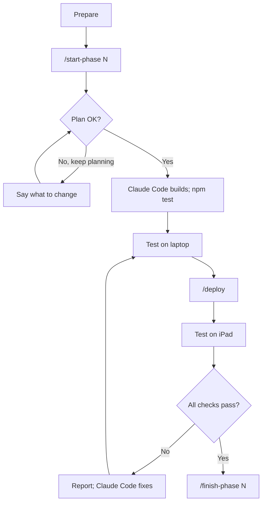

# Workflow

How each phase gets built, tested and closed. Written for Daniella; Claude Code reads the parts its skills point to.

## Contents

1. [The loop at a glance](#1-the-loop-at-a-glance)
2. [Before a phase](#2-before-a-phase)
3. [Starting the session](#3-starting-the-session)
4. [Reviewing the plan](#4-reviewing-the-plan)
5. [While Claude Code builds](#5-while-claude-code-builds)
6. [Testing on the laptop](#6-testing-on-the-laptop)
7. [Deploying and testing on the iPad](#7-deploying-and-testing-on-the-ipad)
8. [Reporting results](#8-reporting-results)
9. [Finishing a phase](#9-finishing-a-phase)
10. [Pausing and resuming](#10-pausing-and-resuming)
11. [When something goes wrong](#11-when-something-goes-wrong)
12. [git in plain words](#12-git-in-plain-words)
13. [Renaming the project](#13-renaming-the-project)
14. [Prompts to use if the slash commands are missing](#14-prompts-to-use-if-the-slash-commands-are-missing)

---

## 1. The loop at a glance

Every phase follows the same ten steps in one fresh Claude Code session.

1. **Prepare:** the previous phase is tagged, and the brief's "Before this session" list is ready.
2. **Start** Claude Code in this folder and check that plan mode is on.
3. **Type `/start-phase N`.** Claude Code reads the files and presents a plan.
4. **Review the plan** (§4). Approve it, or ask for changes.
5. **Build:** Claude Code builds and runs the logic tests after each module.
6. **Test on the laptop** at http://localhost:3000 (§6).
7. **Type `/deploy`**, approve the push, and wait 1 to 2 minutes.
8. **Test on the iPad** in the installed app, and on the installed laptop app where the brief says (§7).
9. **Report results** (§8). Claude Code fixes problems; repeat steps 6 to 9 until every check passes.
10. **Type `/finish-phase N`**, confirm each check, and end the session.

To stop partway through a phase, use `/handoff` (§10).

---

## 2. Before a phase

- [ ] The previous phase is finished: its brief says "Status: Done" and `git tag` lists `phase-<previous>`. For Phase 0, `docs/SETUP.md` is complete instead.
- [ ] The brief's "Before this session" list is ready, for example good light for Phase 2 or your Krita file for Phase 5.
- [ ] Any decision the phase needs is confirmed in `DECISIONS.md` §1 (its "Needed by" column).
- [ ] You have 1 to 3 hours. A phase can always be paused with `/handoff`.
- [ ] Optional: read the brief's Goal and "Done when" list, so you know what you will be approving.

---

## 3. Starting the session

**In a terminal (recommended):**

1. Open Windows Terminal or PowerShell.
2. Type `cd C:\Users\danie\MyVirtualPet` and press Enter.
3. Type `claude` and press Enter.
4. The first time only, Claude Code asks whether you trust this folder. Choose yes. The project's settings and skills load only in a trusted folder.
5. Check that the status bar shows `⏸ plan mode on`. The project sets plan mode as the default. If it isn't on, press Shift+Tab until it is.
6. Type `/start-phase N`, for example `/start-phase 2`, and press Enter.

**In the Claude desktop app (the Code tab), which this project uses** (`DECISIONS.md` §3):

- Start a new session on this folder from the sidebar. Before typing a command, check that the mode menu by the message box says **Plan**; a session you reopen can come back in another mode. Wherever these docs say Shift+Tab or the status bar, use that menu.
- When a plan is ready, the app shows it in a card. Approve it there; if the card offers a choice, pick the one that asks before each change for Phase 0.
- To continue a session later, reopen it from the sidebar (instead of `claude --continue`). To start fresh, start a new session (instead of `/exit` and `claude`).
- To share a screenshot, paste or drag it into the message box (instead of Alt+V).

**In VS Code:** open Claude Code on this folder, and turn on plan mode yourself before typing the command.

**Start each phase in a fresh session.** Type `/exit` or close the window, then run `claude` again. A new session starts clean, and the files carry everything over: `CLAUDE.md`, `DECISIONS.md`, the briefs and the handoff.

---

## 4. Reviewing the plan

`/start-phase` makes Claude Code present a plan under fixed headings: Goal, Files, Order of work, Tests, How each check will be met, Numbers the plan does not give, Additions, Problems found, Questions.

**Check before approving:**

- [ ] **Only this phase.** Nothing from the brief's "Not in this phase" list.
- [ ] **Every file has a reason,** and every file is one the brief or PLAN §4.4 expects.
- [ ] **No invented numbers.** New numbers are listed under "Numbers the plan does not give", and you agree with them.
- [ ] **Additions are named,** each with a reason. None are hidden in the file list.
- [ ] **The engineering rules are intact:** the event names, `storage.js` as the only storage, no URL changes, relative paths, pinned versions.
- [ ] **Problems found and questions are answered.**

**How to respond.** When the plan is ready, Claude Code shows three choices:

- **"No, keep planning":** type what to change. Ctrl+G opens the plan in a text editor so you can edit it directly.
- **"Yes, manually approve edits":** approve the plan and then approve each file change as it happens. Best for Phase 0, while you learn the flow.
- **"Yes, and use auto mode"** (shown as **"Yes, auto-accept edits"** when auto mode isn't available): approve the plan and let edits go ahead without asking. Faster. git still lets you undo anything, and the project settings always ask before pushing or discarding work.

---

## 5. While Claude Code builds

- It runs `npm test` after each module and fixes a failing test before moving on.
- It may ask questions. Answer in plain words; "use your suggested default" is a valid answer.
- If it wants something outside the plan, it must call it an **addition** and give a reason. Answer yes or no. A yes gets logged in `DECISIONS.md` §2.
- It commits at sensible points. Commits stay on the laptop until `/deploy` or `/finish-phase`.
- It never changes anything in `.claude/` (settings and commands) unless you explicitly ask for that specific change. If it ever asks to write there unprompted, say no.
- If it drifts, for example building the next phase's features or adding a library, say: "Stop. That's outside Phase N. Undo it and stay within the brief."
- When the build is done, it gives you the brief's laptop test script.

---

## 6. Testing on the laptop

1. Open a second terminal and keep Claude Code running in the first.
2. Type `cd C:\Users\danie\MyVirtualPet`, then `npm run serve`. It shows http://localhost:3000. Leave it running.
3. If Windows Firewall asks about Node.js, choose Cancel. The server is only for this laptop.
4. Open http://localhost:3000 in Edge. Allow the camera when asked (Phase 0, and from Phase 2).
5. Follow the brief's **Laptop** test script step by step, noting anything unexpected.
6. To stop the server later, click its terminal and press Ctrl+C.

**Notes**

- `localhost` counts as a secure page, so the camera works here without HTTPS.
- The **installed** laptop app uses the GitHub Pages address, not localhost. Test it after `/deploy` wherever the brief asks.
- The developer panel opens when you tap or click the version label 5 times within 3 s (from Phase 1; in Phase 0 this opens the error log).
- If the page looks stale, reload once. If it still looks stale, press Ctrl+Shift+R.

---

## 7. Deploying and testing on the iPad

**Deploying**

1. Type `/deploy`. Claude Code runs the tests, raises the version (for example 0.2.3 to 0.2.4), shows the files, commits, and asks to push. Approve the push.
2. Wait 1 to 2 minutes. To check: on github.com, open your repository and go to the Actions tab. "pages build and deployment" shows a green tick when the new version is live.

**First time on the iPad (Phase 0)**

1. Open Safari and go to `https://<your-username>.github.io/my-virtual-pet/`.
2. Tap Share, then Add to Home Screen. Keep **Open as Web App** switched on, then tap Add.
3. Optionally drag the icon into the Dock.

**Each test**

1. Open the app from the Home Screen, not from Safari.
2. Check the version label in the corner matches the version `/deploy` reported.
3. If it shows an old version, close the app fully (swipe up from the bottom and hold, then swipe the app away) and open it again. If it is still old, wait a minute and repeat.
4. Follow the brief's **iPad** test script.

**Things that are normal on the iPad**

- The app asks for camera permission every time it starts. This is how iPadOS treats Home Screen web apps, not a bug in the app. Tap Allow.
- The green dot at the top of the screen shows the camera is on. It should disappear when you leave the app.

**Caution:** deleting the app from the Home Screen deletes its saved cat. During Phases 0 to 5 this doesn't matter. From Phase 6 on, export a backup first (A3).

---

## 8. Reporting results

Tell Claude Code, for each problem:

- **Device and version:** for example "iPad, 0.2.4".
- **Step:** the step number in the brief's test script.
- **Expected and seen:** what should have happened, and what happened instead.
- **Errors:** open the error log (tap the version label 5 times, then Errors), tap Copy, and paste the text.
- **Screenshot**, if it helps. On the iPad, press the top button and volume up together. To get it onto the laptop, use iCloud Photos for Windows or email it to yourself. In the Claude Code terminal, Alt+V pastes a copied image.

For results that pass, "steps 1 to 7 passed on the laptop" is enough.

---

## 9. Finishing a phase

Type `/finish-phase N`. Claude Code will:

1. Run the tests; all must pass.
2. Go through every "Done when" check. For checks proved by tests it shows the evidence. For device checks it asks you to confirm each one (yes or no). Only you can confirm a device check.
3. If anything is a no, stop and propose fixes. The phase stays open.
4. Otherwise tick the checklist, set the brief's Status line, fill the phase log and the other sections of `DECISIONS.md`, delete `docs/HANDOFF.md` if present, and update the status line in `README.md`.
5. Commit, tag `phase-N`, and push. You approve the push.
6. Tell you what the next phase needs.

Then end the session. The next phase starts fresh.

---

## 10. Pausing and resuming

- **To pause:** type `/handoff`. Claude Code writes `docs/HANDOFF.md` (what is done, the exact next step, decisions, device results, open problems) and commits it on the laptop.
- **When to pause:** whenever you need to stop mid-phase, or when Claude Code says the conversation is getting long.
- **Why a handoff file instead of one long conversation:** very long conversations get summarised automatically and details can be lost. The handoff file keeps them exactly.
- **To resume:** start a new session and type `/start-phase N`. It reads the handoff first and continues from the next step.
- **Short break:** `claude --continue` reopens the most recent conversation in this folder.

---

## 11. When something goes wrong

| Problem | What to do |
| --- | --- |
| A logic test fails | Nothing; Claude Code fixes it before moving on. |
| A device check fails | Report it (§8). Claude Code fixes it, then `/deploy` again and retest. Don't finish the phase. |
| The camera won't start on the iPad | Tap Try again. Then close the app fully and reopen it. Check that Settings → Apps → Safari → Camera isn't set to Deny. Copy the error log to Claude Code. |
| The iPad shows an old version | Close the app fully and reopen it; wait a minute; check the Actions tab on GitHub shows a green tick. |
| Claude Code builds things outside the phase | Say: "Stop. That's outside Phase N. Undo it and stay within the brief." |
| Claude Code says part of the plan won't work | It proposes the smallest fix. You decide, and it records the decision in `DECISIONS.md`. |
| Phase 0 fails on the iPad | Stop. Choose between the options in `docs/phases/phase-0.md`. Don't start Phase 1. |
| You want to undo the current phase's work | Ask: "Show me what changed since tag phase-<previous>, then restore the project to that tag." Claude Code explains first and asks before discarding anything. |
| A push is rejected | Claude Code explains why, usually sign-in or changes on GitHub it doesn't have. It never force-pushes. |
| git asks you to sign in | A browser window opens (Git Credential Manager). Sign in to GitHub once. |
| Claude Code asks to approve a command | Read it and approve it if it matches what Claude Code said it would do. Pushes and anything that discards work always ask. |
| Plan mode isn't on at the start | Press Shift+Tab until the status bar shows plan mode. Type `/status`: "Setting sources" should list the project settings. If it doesn't, check that `.claude\settings.json` exists (installed in step 0 of the kickoff) and that you trusted the folder. |
| The slash commands don't appear | Check that `.claude\skills\` holds the four skill folders (installed in step 0 of the kickoff), then restart Claude Code. Until then, use the prompts in §14. |

---

## 12. git in plain words

- **Commit:** a saved snapshot of the project with a message. It stays on the laptop until pushed.
- **Push:** sends commits to GitHub, which republishes the app on GitHub Pages.
- **Tag:** a named bookmark on a commit. `phase-0`, `phase-1` and so on mark each finished phase.
- **Restore to a tag:** bring the files back to how they were at that bookmark.
- **You never need to type git commands yourself.** Claude Code runs them and explains each step. To look for yourself: `git log --oneline` shows the history, `git tag` the phase bookmarks, and `git status` any unsaved changes.
- **The repository is public.** Anyone can see committed files. Your Krita files in `art/source/` are excluded, and your commits use GitHub's private noreply email (SETUP §4).

---

## 13. Renaming the project

- **The folder:** rename it any time Claude Code isn't running. No code depends on the folder name, but these docs use `C:\Users\danie\MyVirtualPet` in their examples; ask Claude Code to update those lines afterwards. Earlier conversations won't appear in `claude --continue` afterwards, which doesn't matter because the files carry everything.
- **The app's name (D8):** Phase 6 sets the name, short name and window title.
- **The GitHub repository:** renaming it changes the app's web address from `…github.io/my-virtual-pet/` to `…github.io/<new-name>/`. The installed apps point at the old address, so reinstall on both devices. The iPad app's saved cat does not carry over to a new install. Rename before Phase 6 if you can; otherwise export a backup first (A3). Afterwards, ask Claude Code to update the remote address (`git remote set-url origin <new address>`).

---

## 14. Prompts to use if the slash commands are missing

Paste these in place of the commands. Replace N with the phase number.

**Instead of `/start-phase N`**

> Start Phase N of My Virtual Pet in plan mode. Read DECISIONS.md, docs/HANDOFF.md if it exists, docs/phases/phase-N.md and the PLAN.md sections that brief lists. Run git status, git log --oneline -5 and git tag, and check the previous phase's tag exists. Then present a plan under these headings: Goal, Files, Order of work, Tests, How each "Done when" check will be met, Numbers the plan does not give, Additions, Problems found, Questions. Don't change any file until I approve.

**Instead of `/deploy`**

> Deploy: run npm test and stop if anything fails. Raise APP_VERSION in src/version.js and line 1 of sw.js. The format is 0.N.x, where N is the latest phase tag plus 1; if N has changed since the last deploy, use 0.N.1. Run npm test again. Run git add -A and show me git status --short, checking nothing from art/source or node_modules is included. Commit as "deploy <version>: 
", push to origin main, then tell me the version, the address, and what to test on the iPad.

**Instead of `/handoff`**

> Write docs/HANDOFF.md for this phase: phase and date, where we are, done this session, the exact next step, what remains from the brief, decisions made (and make sure they're in DECISIONS.md), device results so far, open problems, and approaches that failed. Commit it as "phase N: handoff notes" without pushing.

**Instead of `/finish-phase N`**

> Finish Phase N: run npm test. Go through every "Done when" check in docs/phases/phase-N.md, showing evidence for test checks and asking me to confirm each device check; stop if any isn't confirmed. For Phase 6, first set APP_VERSION to 1.0.0 in src/version.js and line 1 of sw.js and run npm test again. Then tick the checks, set the brief's Status line, update DECISIONS.md (phase log, versions, tuned values, chosen numbers, additions, plan changes), delete docs/HANDOFF.md if present, update the README status line, commit "phase N complete", create the annotated tag phase-N, and push with --follow-tags.
